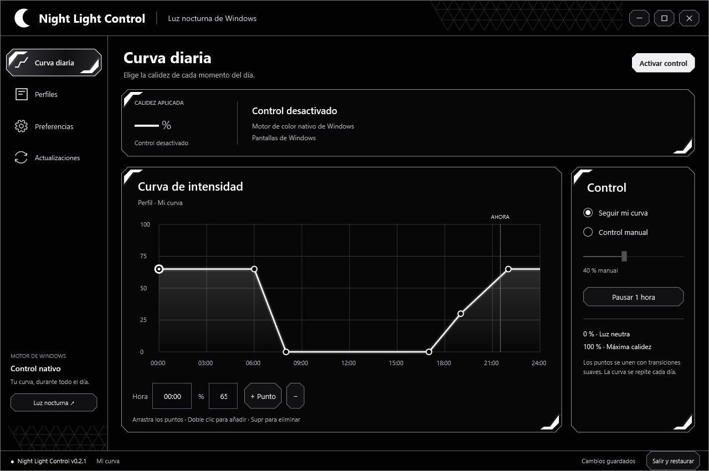
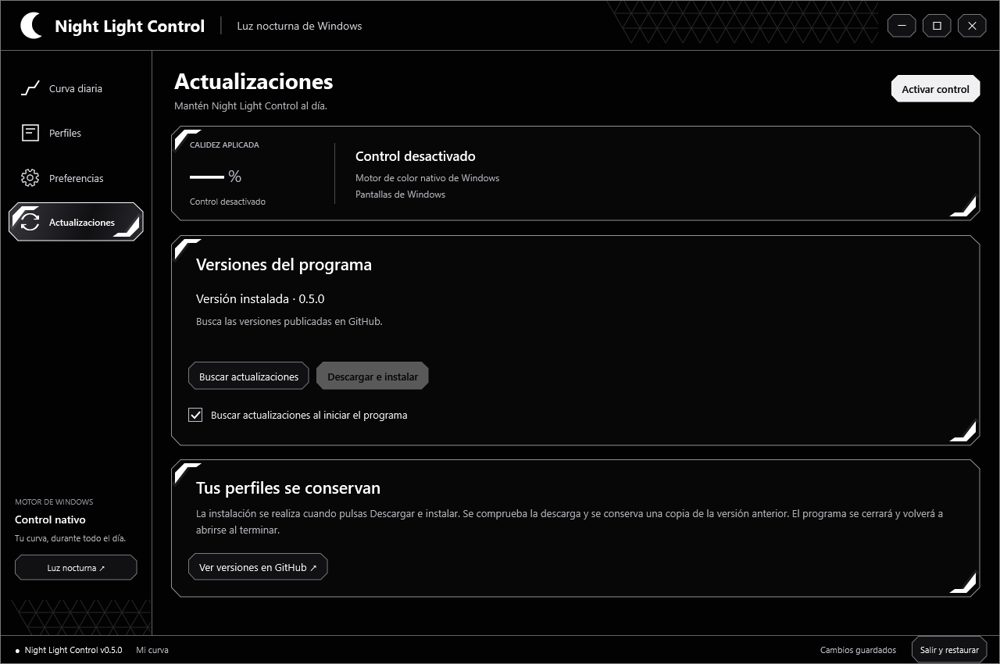

# Night Light Control

Aplicación para Windows 11 x64 que ajusta la Luz nocturna nativa siguiendo una
curva diaria dibujada por el usuario. Versión preliminar: **0.4.0**.

[Descargas para Windows x64](https://github.com/Esteban-3055/Night-Light-Control/releases)
· [Compilaciones y comprobaciones](https://github.com/Esteban-3055/Night-Light-Control/actions)



La interfaz utiliza una paleta negra y blanca, paneles angulares y un gráfico
luminoso. La barra lateral da acceso a **Curva diaria**, **Perfiles** y
**Preferencias** y **Actualizaciones**. La imagen es una vista generada desde la interfaz real con
valores de ejemplo, sin controlar una pantalla física.

## Uso

Para una instalación normal, descarga **NightLightControl-0.4.0-Setup.exe** desde
[las versiones publicadas](https://github.com/Esteban-3055/Night-Light-Control/releases).
El instalador añade el programa a Inicio y a Aplicaciones instaladas, con un
desinstalador, y permite crear un acceso en el escritorio. No necesita permisos
de administrador. Por defecto utiliza `%LOCALAPPDATA%\Programs\Night Light Control`.
La versión ZIP continúa disponible como portable.

Los perfiles existentes se conservan automáticamente en su carpeta local. El
inicio con Windows pasa a apuntar a la instalación nueva. No se eliminan las
carpetas del proyecto ni las copias portables previas.

1. Cierra otras aplicaciones que ajusten el color de la pantalla.
2. Abre `NightLightControl.exe`.
3. Arrastra los puntos de la curva para elegir la hora y la intensidad. El eje
   horizontal cubre 24 horas y el vertical va de 0 a 100 %. La curva se repite
   cada día y continúa de forma suave al cruzar medianoche.
4. Haz doble clic en el gráfico para añadir un punto. Selecciona uno para editar
   su hora e intensidad exactas debajo del gráfico. Supr o el botón − eliminan
   el punto seleccionado; siempre se conservan al menos dos puntos.
5. Pulsa **Guardar curva** para guardar inmediatamente los puntos y los valores
   exactos que acabas de editar. También se conserva el guardado automático.
6. Pulsa **Activar control** con **Seguir mi curva** seleccionado.

Al desactivar, el programa vuelve gradualmente al color solicitado por Windows
con la misma velocidad que al activarse. Si lo reactivas a mitad de esa salida,
la transición continúa desde el color actual. El indicador permanece visible
mientras termina la salida gradual.

En **Perfiles**, los cambios se guardan automáticamente. Puedes duplicar,
renombrar y eliminar perfiles. **Control manual** permite fijar temporalmente
una intensidad. **Pausar 1 hora** devuelve el control a Windows durante ese
tiempo; **Reanudar** cancela la pausa.

En **Preferencias** se encuentran el inicio con Windows, la velocidad de cambio,
la pausa en pantalla completa y las exclusiones por aplicación. Las exclusiones
se aplican a la ventana que está en primer plano. Escribe nombres como
`Photoshop.exe, juego.exe`. El inicio automático usa la ruta del ejecutable;
si mueves la carpeta, desmarca y vuelve a marcar esa opción.

## Actualizaciones

En **Actualizaciones** puedes buscar versiones publicadas en este repositorio.
La búsqueda al iniciar está activada de forma predeterminada y puede desmarcarse.
Se incluyen las versiones preliminares publicadas. No se instala nada sin pulsar
**Descargar e instalar**.

La descarga se comprueba con SHA256 antes de reemplazar el ejecutable. El programa
restaura el color de Windows, se cierra y abre la nueva versión. Los perfiles y
preferencias permanecen en su carpeta local; se conserva el ejecutable anterior
como `NightLightControl.exe.previous`. La actualización requiere permiso de
escritura en la carpeta portable.

En una instalación registrada, el actualizador descarga el instalador de la
versión nueva. Lo ejecuta después de cerrar y restaurar el programa, conserva
las preferencias de inicio y escritorio, y actualiza el registro de Windows.
La versión portable sigue actualizando solo su ejecutable.

Para desinstalar, utiliza **Configuración → Aplicaciones → Aplicaciones
instaladas → Night Light Control → Desinstalar**. Se conservan los perfiles y
preferencias en `%LOCALAPPDATA%\NightLightControl`. El programa y sus accesos se
eliminan; los archivos de usuario ajenos a la instalación se conservan.



Cerrar la ventana mantiene el programa en la bandeja. Para terminar, utiliza
**Salir y restaurar** en la ventana o en el menú del icono junto al reloj.
La primera apertura deja el control desactivado para que puedas elegir tu curva.

## Motor de Windows

No crea una capa de color ni utiliza SetDeviceGammaRamp. Consulta la capacidad
de cada pantalla mediante las interfaces internas de Windows y aplica Kelvin
con el servicio de pantalla o InternalSetDeviceTemperature, según lo que Windows
indique. La conversión es 6500 − 53 × intensidad: 0 % = 6500 K, 100 % = 1200 K.
El indicador de Luz nocturna de Configuración rápida puede seguir mostrando el
estado guardado por Windows, porque la aplicación cambia la temperatura durante
la ejecución sin reescribir esos registros.

El cierre normal, la desactivación y las pausas restauran la temperatura que
Windows solicita en ese momento. El control se suspende mientras se utiliza
la vista previa del deslizador nativo de Windows o si se detecta un conflicto
con otra aplicación de ajuste de color.
La aplicación atiende los cambios de pantalla, suspensión y desbloqueo.
Al cambiar la proyección de Windows, conserva la intención de control y la
intensidad mientras se reconstruye la lista de pantallas. Reintenta las salidas
que desaparecen temporalmente y reaplica la calidez en la pantalla restante.
Windows o el controlador gráfico pueden seguir provocando una transición visible
durante el cambio de modo; no se ha validado físicamente cada combinación de TV.

Si utilizas el horario propio de Windows, desactívalo manualmente para que no
compita con tu curva. La aplicación no modifica ese ajuste.

Las interfaces son privadas y una actualización de Windows puede afectar su
compatibilidad. HDR, videojuegos y suspensión/reanudación física necesitan
pruebas específicas; el éxito de una llamada no confirma la apariencia del panel.

## Cierres inesperados y estado de Windows

La aplicación no cambia los registros guardados de Luz nocturna. Sin una
restauración, la transformación de color aplicada durante la ejecución puede
continuar después de matar el proceso, hasta que Windows vuelva a aplicar su
estado. No equivale a cambiar permanentemente la configuración de Windows.

La opción **Restaurar color tras un cierre inesperado**, activada por defecto,
prepara un auxiliar independiente antes de aplicar color. Este espera a que
termine el proceso principal. Si el control seguía siendo responsable del color,
intenta aplicar la temperatura que Windows solicite entonces. Respeta la vista
previa del deslizador nativo y reintenta si el controlador falla temporalmente.
Un cierre normal desarma la recuperación después de restaurar el color.

El auxiliar se ejecuta sin ventana, servicios ni permisos de administrador.
Utiliza una copia del ejecutable portable en la carpeta local de recuperación,
conservada por versión. La protección no está garantizada si se terminan ambos
procesos, se mata todo el árbol o Windows/controlador no acepta el cambio. En
ese caso, abre Luz nocturna de Windows y actívala/desactívala para que Windows
vuelva a aplicar su estado.

La revisión y los límites de validación se detallan en [REVISION.md](docs/REVISION.md).

## Archivos y desarrollo

Configuración: `%LOCALAPPDATA%\NightLightControl\settings.json`.
Registro de errores: `%LOCALAPPDATA%\NightLightControl\diagnostic.log`.
No necesita administrador, controlador adicional, Windhawk ni conexión a Internet.

Requiere .NET SDK 10 para compilar:

```powershell
dotnet build -c Release
dotnet run --project tests/NightLightControl.Tests.csproj -c Release
./scripts/Build-Portable.ps1
./scripts/Build-Installer.ps1
```

El script comprueba el código y genera el ejecutable, el ZIP y sus sumas SHA256.
GitHub Actions realiza las mismas comprobaciones en Windows y publica una
versión preliminar cuando se sube una etiqueta `v*`.

Las pruebas normales no modifican las pantallas ni abren la interfaz. Para una
prueba física opcional puede ejecutarse:

```powershell
dotnet run --project tests/NightLightControl.Tests.csproj -c Release -- --native
```

La prueba `--native` cambia brevemente la calidez y la restaura. Cierra la
aplicación y otros controladores de color antes de ejecutarla. `--diagnose --out archivo.json` solo
consulta Windows; `--verify-native --out archivo.json` aplica un cambio pequeño
durante 1,5 segundos y lo restaura. La distribución portable incluye .NET.

Para generar vistas de las cuatro secciones, sin crear ventanas ni activar el
controlador de color:

```powershell
dotnet run --project tests/Preview/Preview.csproj -c Release -- . output/previews
```

La compilación automática no prueba HDR, videojuegos, suspensión física ni la
apariencia real del panel. Las pruebas de hardware locales de la versión 0.1.0
comprobaron la aceptación de cambios y restauración en Windows 11 25H2 con dos
pantallas, conservando intactos los registros de Luz nocturna. El rediseño 0.2.0
mantiene ese motor y se comprueba mediante compilación, pruebas y vistas pasivas.

Consulta `THIRD-PARTY-NOTICES.txt` para las atribuciones del motor nativo.
